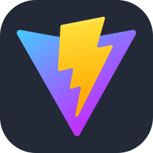
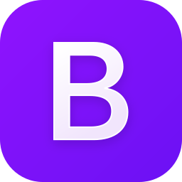
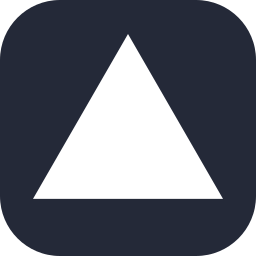
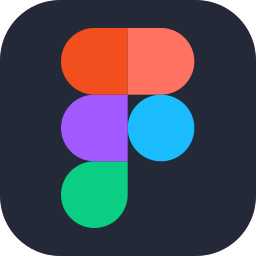
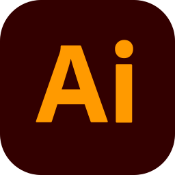

  

# Hi, I'm Bhupoti Kumar Roy 👋

Passionate about building scalable applications, clean architectures, and exceptional user experiences.

  
  
  

 

---

## 👨‍💻 About Me

I'm **Bhupoti Kumar Roy**, a Backend-Focused Full-Stack Developer passionate about building scalable, secure, and maintainable web applications.

I enjoy working across the entire development lifecycle, from designing backend architecture and RESTful APIs to building responsive and intuitive frontend experiences.

My primary focus is backend engineering, where I prioritize clean architecture, data integrity, security, performance, and long-term maintainability.

---

## 🧰 Tech Stack & Tools

### Languages

  
  
  
  
  

### Frontend Development

  
  
  
  
  
  
  
  
  
  
  
  
  

### Backend Development

  
  
  
  
  
  
  

### Database

  
  
  

### DevOps, Tools & Platforms

  
  
  
  
  
  
  
  
  
  
  
  
  
  
  
  
  
  
  

---

### 💡 Building with purpose. Engineering for scale.

_Always learning. Always improving. Always building._

